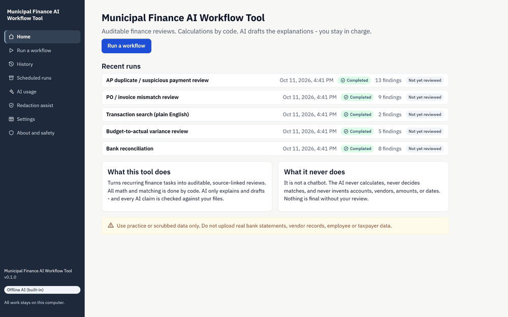
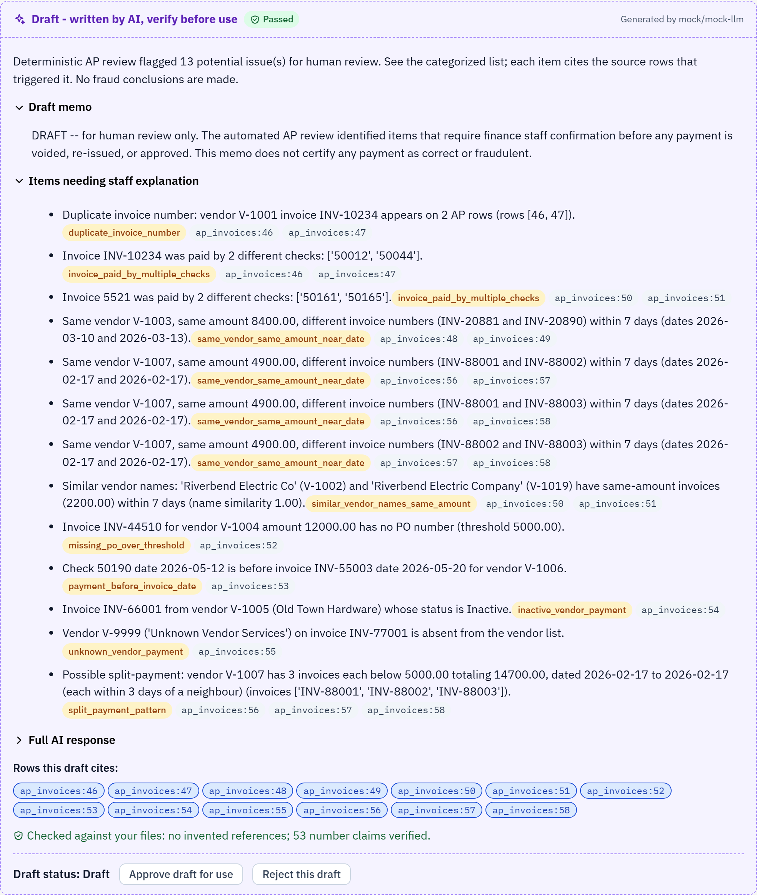
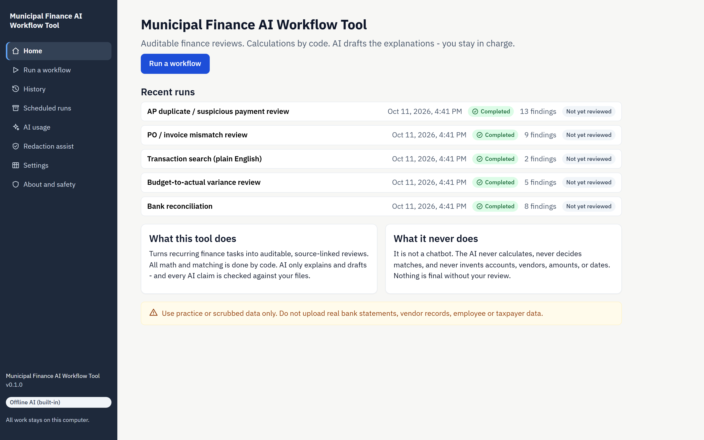
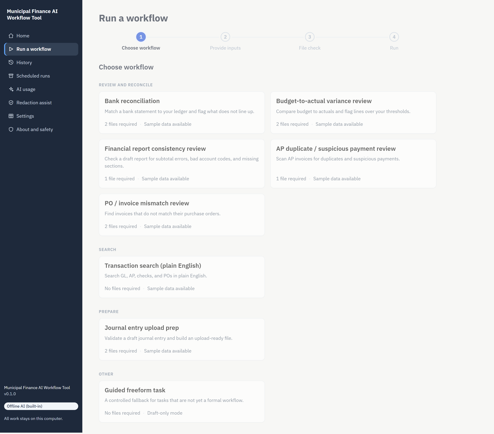
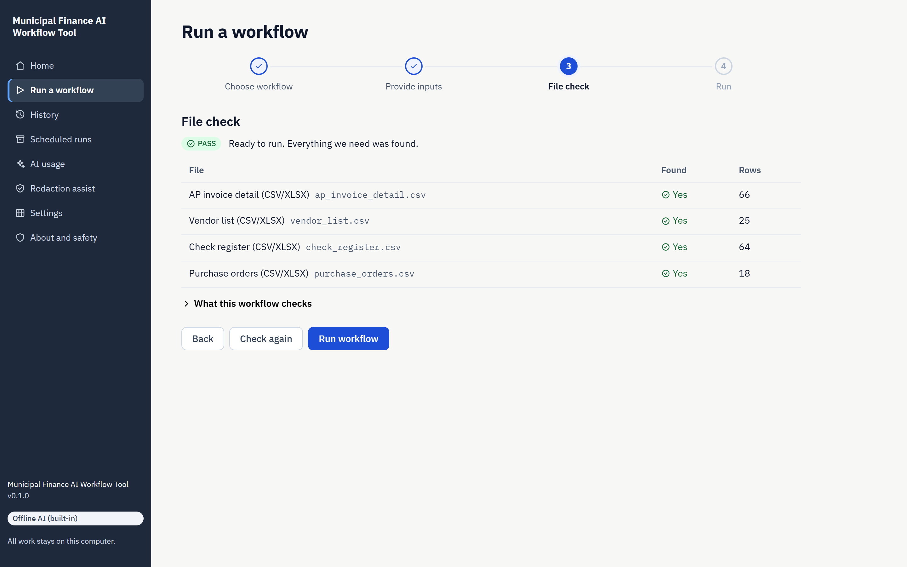
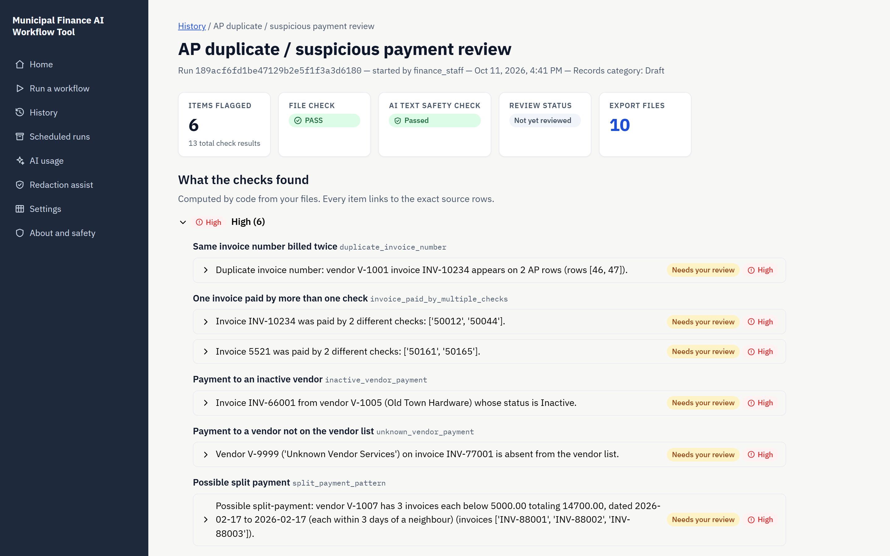
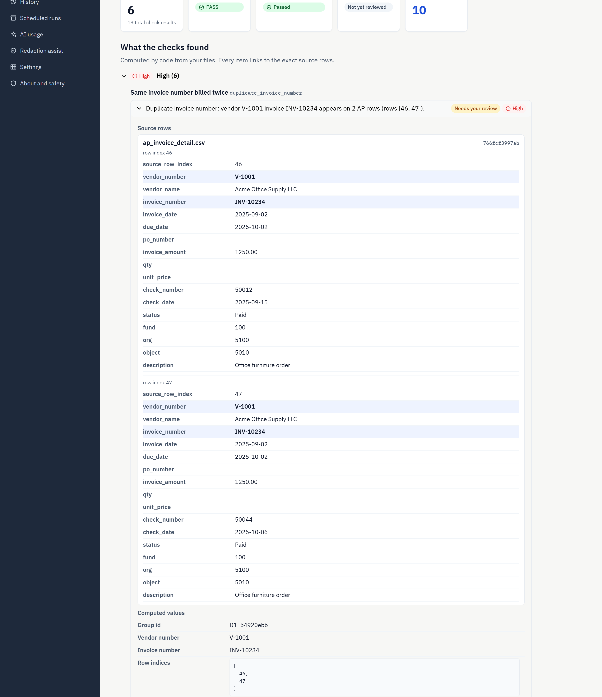
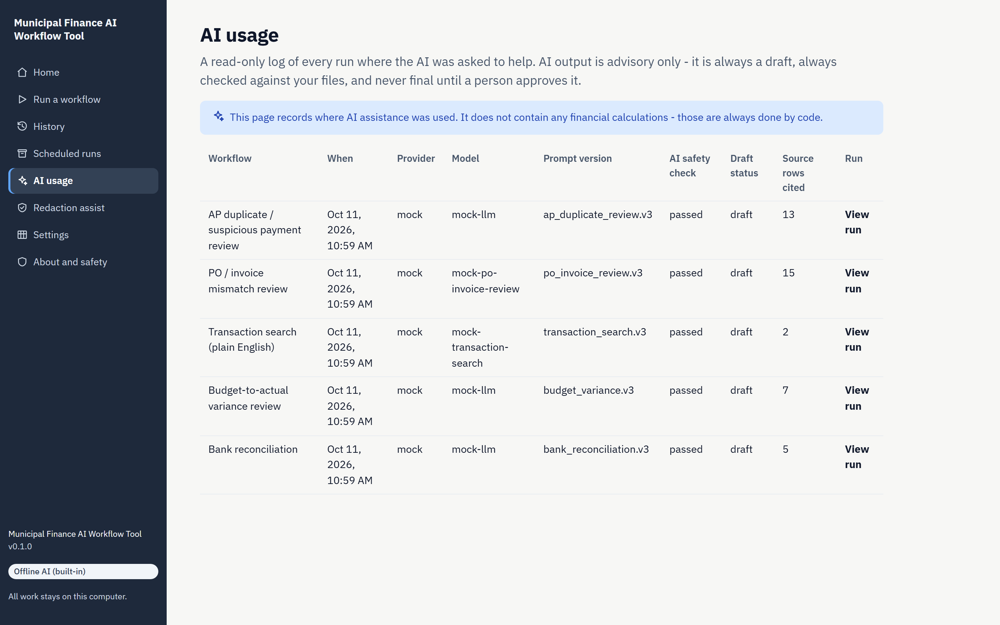

<div align="center">

# Municipal Finance AI Workflow Tool

**Auditable finance reviews. Calculations by code. AI drafts the explanations — a human stays in charge.**

A local-first tool that turns recurring, error-prone municipal finance tasks into
source-linked, reviewable workflows. It is a controlled workflow runner, **not a
chatbot**: every calculation is deterministic Python, and the model is used only
for language — drafting explanations and answering questions about a single run,
always grounded in that run's own data, validated the same way, and logged.


</div>

<p align="center">
  
</p>

> **MVP on synthetic data only.** Everything in the public repository is fabricated
> for demonstration — no real bank statements, vendors, PII, secrets, or ERP
> integrations. The project does not connect directly to a live Tyler/Munis
> installation. See the [architecture decisions](docs/decisions.md) and
> [evaluation](docs/evaluation.md).

---

## The problem

Small-city finance teams repeat the same manual, error-prone tasks every month and
quarter: reconciling a bank statement against a ledger, explaining budget variances,
checking a draft report before it goes into an agenda packet or audit. These tasks are
tedious and easy to get wrong — but they demand exactness and an audit trail.

This project was independently proposed and developed after interviews with finance
staff surfaced records-retention and auditability risks around the use of individual
AI accounts for work-related tasks.

A general chatbot is the wrong tool. Finance staff can't trust a black box that might
invent an account number or miscalculate a variance, and auditors need to see where
every number came from. The users here are **non-technical**, need no prompt
engineering, and distrust black-box financial outputs.

## The core idea: a hard trust boundary

The whole design rests on one line:

> **Deterministic code does all the math and matching. The LLM only drafts language and
> must cite source rows. Every run is logged, validated, and exported for a human to approve.**

| | Deterministic core (Python) | The model |
| --- | --- | --- |
| **Does** | Parse, clean, normalize, match, compute every variance/total, validate, track source rows, export, audit-log | Explain, summarize, draft, classify, flag — in plain language |
| **Never** | Delegates a calculation or a match to the model | Calculates, decides a match, or invents an account/vendor/amount/date |

This is enforced two ways. Each workflow builds the LLM prompt **only** from the
deterministic findings, and a deterministic validator checks every number, date,
identifier, and row reference in the response against those findings: anything that
isn't there **rejects the draft** ([exact rules](docs/evaluation.md#real-model-guardrail-results)). The AI's output is always labelled a **draft** and
shown in a visually distinct trust boundary until a human approves it.

<p align="center">
  
</p>

<div align="center"><sub>Every AI claim cites its source rows · validated against the files · <b>Approve</b> or <b>Reject</b> before it counts.</sub></div>

The model runs on a built-in **mock provider by default** — deterministic, no API key,
no internet — so the entire tool runs offline. A real OpenAI-compatible or Anthropic
provider is opt-in (see [Using a real model](#configuring-a-real-llm)) and passes the
exact same guardrails, [measured below](#measured-results).

## A run, end to end

The React console guides a non-technical user through four steps — **choose a workflow →
provide inputs → file check → run** — then opens the review page, with progressive
disclosure so they're never staring at a blank form.

<table>
  <tr>
    <td width="50%"><br><sub><b>Home</b> — recent runs, what the tool does and never does, offline badge.</sub></td>
    <td width="50%"><br><sub><b>Choose a workflow</b> — eight review/search/prepare workflows; seven ship with sample data.</sub></td>
  </tr>
  <tr>
    <td width="50%"><br><sub><b>File check (preflight)</b> — profiles the files before running; PASS / PARTIAL / FAIL.</sub></td>
    <td width="50%"><br><sub><b>Review</b> — summary strip, deterministic findings, AI safety check, exports.</sub></td>
  </tr>
</table>

Expanding any finding shows the **actual cell values** of every source row it cites —
grouped by document, with the driving fields highlighted and provenance (file name and
absolute row index on every row, the file's recorded SHA-256 hash per document). The UI
does no financial math: every amount, variance, match, and finding comes from the
backend; the browser only groups and counts findings for display.

<p align="center">
  
</p>

Every AI interaction — workflow drafts and run-scoped Q&A alike — lands in the
**AI usage log** with its model, prompt-template version, validation status, and
draft-vs-approved state: a CPRA-style review surface for AI usage.

<p align="center">
  
</p>

## Supported workflows

Eight workflows share one pipeline and run end to end from the React console, the CLI,
or a chat assistant over MCP, all on bundled synthetic data.

| Workflow | What the code does (deterministic) | What the AI does |
| --- | --- | --- |
| **Bank reconciliation** | Match a bank statement to the ledger by amount/date with tolerances; flag unmatched items, timing differences, duplicates; compute totals. | Explain unmatched items, citing source rows. |
| **Budget-to-actual variance** | Join budget to actuals; compute dollar and percent variance; flag lines over threshold and missing accounts. | Draft variance commentary referencing flagged rows. |
| **Report consistency review** | Check a draft report for subtotal mismatches, invalid codes, duplicates, missing sections, large prior-version changes. | Explain each issue; draft a review checklist. |
| **Transaction search** | Parse plain English into a schema-validated `SearchCriteria`; apply as deterministic pandas filters over GL/AP/check/PO exports. | Translate the query to structured JSON; summarize matches. |
| **AP duplicate / suspicious payment** | Nine checks (D1, D1b, D2–D8): duplicate invoices, payment by multiple checks, same-vendor/amount near-date pairs, similar vendor names, missing PO, payment-before-invoice, inactive/unknown vendor, split payments (one finding per cluster). | Summarize flagged issues; draft review notes — never concludes fraud. |
| **JE upload prep** | Validate a draft journal entry against the chart of accounts and fiscal period; produce an upload-ready workbook **or** a blocking error report. Fail-closed. | Draft a validation summary; never edits the workbook. |
| **PO / invoice mismatch** | Nine checks (P1–P8 + P3b) joining PO and AP exports: invoice-over-PO, wrong vendor, missing/closed PO, price/qty mismatch, received-vs-invoiced. | Summarize mismatches; draft review notes — never declares an invoice improper. |
| **Guided freeform** | A structured (not chat) fallback routing ad-hoc tasks through the same logging and validation; **fails closed** unless sensitivity is confirmed. | Produce a source-linked DRAFT for human review. |

Four workflows consume **Tyler/Munis-style ERP exports** through a deterministic
normalizer (`src/ingest/tyler.py`) with header-overlap dataset detection, SHA-256 input
hashing, source-row tracking, and `Decimal` amount parsing. It accepts the layouts real
Munis output uses (verbatim headers from public Munis reports and Tyler documentation:
title blocks, `TOTAL`/`END OF REPORT` lines, `YR/PR`, one signed `AMOUNT`, Excel serial
dates), tested on synthetic files in those layouts
(`tests/integration/test_munis_layouts.py`). Evidence and what is still open:
[`docs/tyler_assumptions.md`](docs/tyler_assumptions.md).

### Fail-closed preflight

Before any workflow runs, a deterministic **preflight layer** profiles the files against
the workflow's declared capability and returns one of three statuses:

- **PASS** — inputs satisfy the workflow; it runs normally.
- **PARTIAL** — it runs the supported checks, but conditions it doesn't fully handle
  (e.g. a likely sign-convention mismatch) are flagged for human review; the AI may only
  explain the deterministic findings.
- **FAIL** — a required file/column is missing or unparseable; the workflow does **not**
  run, **the LLM is never called**, and the user gets plain-language next steps naming
  the upload, the columns the file actually has, and "this may not be the right file"
  when it clearly isn't.

The model never "takes over" failed workflow logic. Full rules in
[`docs/workflow_capabilities.md`](docs/workflow_capabilities.md).

## Measured results

**The guardrail, against a real model.** Every workflow was run through a real,
inexpensive model (`deepseek-v4.1-flash` via OpenRouter) on the synthetic data, and
every number, date, identifier, and row reference in each draft was checked:

- **Final batch of 24 fresh drafts (1,345 claims checked): 22 accepted as run.** One
  rejection was correct (an empty draft); the other was a false positive (an inline
  "(4) category" list marker read as a number), fixed afterwards. Replayed, that
  draft now passes (23/24), but that fix was tuned on this batch, so it is no longer
  strictly held-out.
- **It catches real hallucinations.** In one run the model named invoice `INV-90065`,
  which exists nowhere in the data. The validator rejected the draft; the validator
  this project started with accepted it (it compared raw text tokens, checked numbers
  in only 3 of 8 workflows, and only as warnings).
- **72 adversarial edits** of real drafts (an invented amount, percent, count, date,
  identifier, or row) are replayed offline on every test run, and all must fail.

**Scale.** Every workflow that takes files (7 of 8; freeform takes a written request)
processes a **50,000-row** export in **under 10 seconds** on a laptop (3–8 s measured on
an idle machine; bank reconciliation was over two minutes, PO review six, AP review over
ten).
The rewritten algorithms with an independent definition (bank matcher, budget rollup
detector, footer detection) are pinned by randomized equivalence tests; the other
speed-ups (row indexes, cached lookups) were checked old-vs-new during review, the last
round with `python -m src.eval.scale --rows 20000 --digest` (a hash of every finding):
identical findings.

Method, per-workflow tables, and the tuning history (including what went wrong):
[`docs/evaluation.md`](docs/evaluation.md). Total spent on real-model calls: $0.125 ([spend log](docs/goal.md#spend-log-append-only)).

## Architecture

```text
            React console             CLI                 MCP server
            (frontend/, via api/)     (cli/)              (mcp_server.py)
            guided 4-step wizard      scripts, batch      Claude / ChatGPT tools
                    │                   │                   │
                    └───────────────────┼───────────────────┘
                                        ▼
  ┌──────────────────────────────────────────────────────────────────────────┐
  │  src/core/pipeline.py  - the one run path (src/workflows/registry.py)    │
  │                                                                          │
  │  CSV / Excel ─▶ preflight (PASS / PARTIAL / FAIL; FAIL stops here,       │
  │                 no LLM call) ─▶ deterministic checks ─▶ findings that    │
  │                 cite source rows                                         │
  │            ─▶ LLM draft (offline mock by default; real model opt-in)     │
  │            ─▶ validation: every number, date, id, and row in the draft   │
  │                 must exist in the findings, or the draft is rejected     │
  │            ─▶ SQLite run ledger + append-only audit log                  │
  │            ─▶ review packet (review_packet.md, run_manifest.json, CSVs)  │
  └──────────────────────────────────────────────────────────────────────────┘
```

| Layer | Owns | Never does |
| --- | --- | --- |
| Core (`src/`) | Parsing, every calculation and match, preflight, validation, source-row tracking, exports, audit log | Delegates a calculation to the LLM or a UI |
| Front ends (`api/`, `cli/`, `mcp_server.py`) | Transport and input handling | Business logic; each calls `pipeline.run_workflow` |
| React console (`frontend/`) | Rendering, review actions, downloads | Financial math: every amount, variance, and match comes from the backend |

The console and the MCP server share one ledger, so a run started from a chat
assistant shows up in the console's history (the CLI uses an in-memory ledger unless
given `--db runs/ledger.db`). The Streamlit prototype that proved the workflows has been
retired in favor of the guided console.

## Getting started

Requires **Python 3.11+** (CI tests 3.12) and **Node.js LTS** (first run only). Runs fully offline by default.

### Deployment status

As of July 2026, the system has been piloted with finance staff as a local,
single-user MVP. The deployment path described below serves the built React console
and FastAPI backend from one local process for evaluation and demonstration. It is not
a hosted multi-user production deployment, and the public repository contains
synthetic data only.

**One command** (Windows: double-click `scripts\launch_console.cmd`):

```bash
python scripts/launch_console.py
```

The first run creates `.venv`, installs the app, builds the console, then opens
`http://127.0.0.1:8765`. Closing the window stops everything. Details and
troubleshooting: [`scripts/README.md`](scripts/README.md).

**CLI** (after the first launch, or `pip install -e .`):

```bash
.venv/Scripts/python.exe cli/run_workflow.py ap-duplicate-review --sample
```

**From Claude or ChatGPT** (MCP): a Claude Desktop extension, installed from Settings and
tested live (`python scripts/build_claude_extension.py`), or ChatGPT Business/Enterprise through
OpenAI's Secure MCP Tunnel, so no port is opened on the laptop. Both render the run
in the chat (findings, source rows, the labelled draft), and tools read files only
from a chosen data folder. Setup and what leaves the computer: [`docs/mcp.md`](docs/mcp.md).

<details id="configuring-a-real-llm">
<summary><b>Using a real model (opt-in)</b></summary>

Copy `.env.example` to `.env` (gitignored) and set `LLM_MODE=real`, `LLM_API_KEY`,
`LLM_BASE_URL`, and `LLM_MODEL`. Any OpenAI-compatible endpoint works (the measured
results above used OpenRouter). For the Anthropic Messages API set
`LLM_PROVIDER=anthropic` with an Anthropic `LLM_MODEL`, and leave `LLM_BASE_URL` and
`LLM_EXTRA_BODY` unset (both are OpenRouter-specific in the example file).
The launcher and MCP server load `.env`; the API reads the same variables from the
environment; the CLI uses the real model only when given `--real`.

The real path passes exactly the same validation as the mock. If the provider fails
(timeout, bad key, empty reply), the run still completes with its deterministic
findings and the draft is marked "AI draft unavailable". Tests never call a real
model: `tests/conftest.py` clears the `LLM_*` variables.

To measure a model yourself: `python -m src.eval.real_llm --repeat 3`.
</details>

## Testing

```bash
.venv/Scripts/python.exe -m pytest -o addopts="" -q     # backend, offline
.venv/Scripts/python.exe -m src.eval.harness              # known-answer checks, 7/7
.venv/Scripts/python.exe -m src.eval.scale --rows 50000   # 50k-row timings
cd frontend && npm test && npm run typecheck && npm run lint
```

**968 backend + 57 frontend tests pass.** CI (`.github/workflows/ci.yml`) runs all of
the above except the scale benchmark. The backend suite includes offline replays of
recorded real-model drafts (`tests/integration/test_real_llm_replay.py`), MCP protocol
tests, and randomized equivalence tests for the rewritten matching, rollup, and
footer-detection algorithms.

## Limitations

Deliberate scope boundaries, not bugs:

- **Local, single-user, no auth.** No accounts or roles; run history lives in a local SQLite file.
- **No live ERP connection.** Inputs are exported CSV/XLSX files, not printed PDF
  reports. Munis layouts were checked against public Munis output, not a city's own
  system: the journal-import template is generated per site, so `je_upload.xlsx` is a
  review workbook to map onto it ([`docs/tyler_assumptions.md`](docs/tyler_assumptions.md)).
- **The validator checks facts, not judgment.** It rejects invented numbers, dates,
  identifiers, and rows, but not a real figure attached to the wrong item, a dropped
  minus sign, or an invented vendor *name* without digits. Every draft stays a draft
  until a human approves it.
- **Synchronous runs.** A 50k-row file takes seconds; much larger files would need a task queue.
- **PDF export is text-only; redaction is a regex prototype**, not a compliance tool.

## Synthetic data disclaimer

Everything in this repository uses **synthetic data only**. There are no real bank
statements, vendor records, employee or taxpayer data, credentials, PII, secrets, or ERP
integrations anywhere in the public project, and it does not connect directly to a live
Tyler/Munis installation. "City of Riverbend" and all vendors, invoices, checks, POs,
and amounts are fabricated. **Do not load real sensitive data into this MVP.**

## Design decisions

The short version (full index: [`docs/decisions.md`](docs/decisions.md)):

- **Code computes, the model writes, a validator checks, a human approves.** The model
  never sees a task it could get numerically wrong; the validator treats any claim not
  found in the findings as an error, not a warning.
- **One pipeline, many doors.** The console, CLI, and MCP server are thin adapters over
  `pipeline.run_workflow`, so a guardrail added once applies everywhere.
- **Measure against reality.** The validator was tuned on real model output, checked on
  held-out batches, and attacked by a review agent before its numbers went in this
  README.
- **Fail closed.** Bad files stop at preflight with plain-language next steps; a broken
  model connection never costs the deterministic results.

---

<div align="center"><sub>Portfolio project · synthetic data only · an auditable, trust-bounded approach to AI in government finance · <a href="LICENSE">MIT license</a>.</sub></div>
