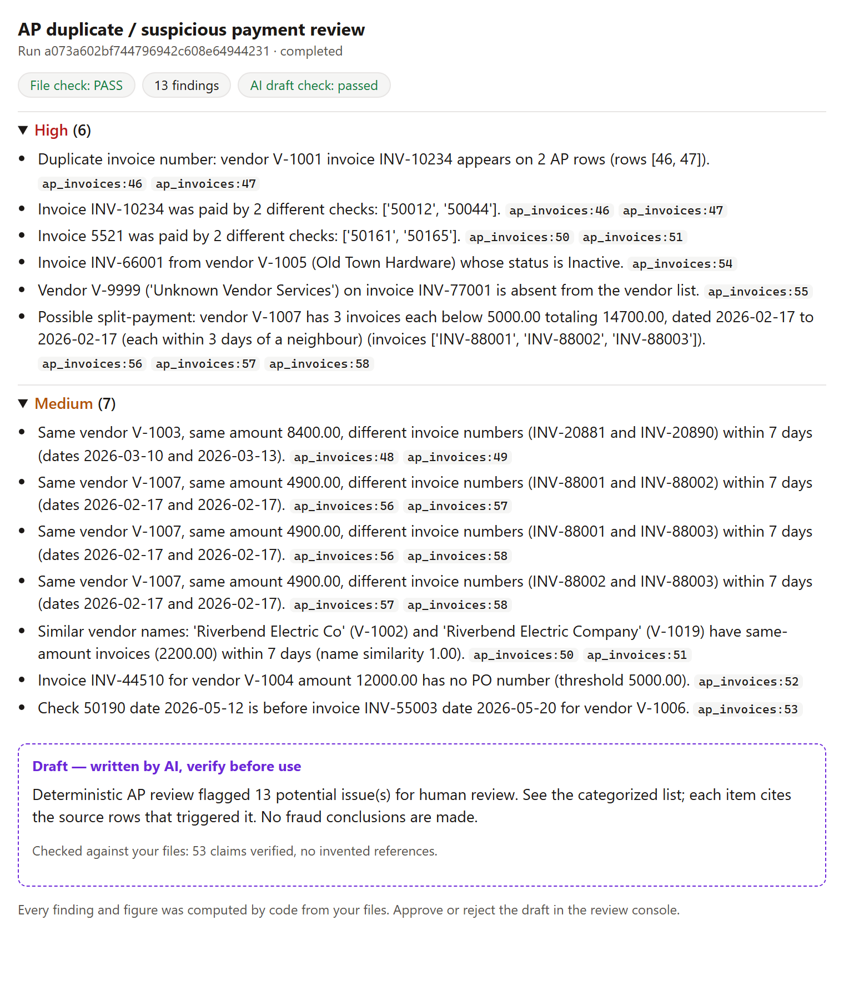

# Using the workflows from Claude or ChatGPT (MCP)

`mcp_server.py` exposes the workflows as [Model Context Protocol](https://modelcontextprotocol.io)
tools. It is a thin adapter like `api/` and `cli/`: same pipeline, same run
ledger, same audit log, so runs started from a chat show up in the console's
history (when both use the same work folder). One server serves both hosts; it
speaks **stdio only** and never opens a network port.

| | Claude Desktop | ChatGPT |
| --- | --- | --- |
| How it connects | Desktop extension (`.mcpb`) or config entry; Claude starts the server on this computer | OpenAI's Secure MCP Tunnel: `tunnel-client` starts the server here and relays over an outbound HTTPS connection |
| Plans | Any; Team / Enterprise owners can allowlist the extension | Business, Enterprise, Edu (developer mode / custom MCP, enabled by an admin) |
| Files | Only from the chosen data folder | From the data folder, or attached in the chat (downloaded from OpenAI) |
| What leaves this computer | Tool results the chat shows (findings, cited cell values, the draft) go to Anthropic as chat content | The same, to OpenAI; attached files are uploaded to OpenAI by ChatGPT first |
| Run view | Rendered (MCP Apps) | Rendered (MCP Apps) |

Both companies' business plans keep this content out of model training by
default; retention follows the workspace's settings. Confirm that sending
finance data to the chosen platform is within the city's approval before
connecting real files.

## Claude Desktop

**Extension (recommended).** Build it once, then share the file:

```bash
python scripts/build_claude_extension.py
```

This writes `dist/govworkflows-<version>.mcpb` from an allowlist of files (code,
the run view, synthetic samples; never `.env` or run history). In Claude
Desktop, double-click it (or Settings → Extensions → Advanced → Install
Extension) and choose:

- **Data folder**: the folder with the finance exports. The tools can read files
  only inside it.
- **Work folder**: where run history, the audit log, and export packets go.
  Point it at the repo's `runs` folder to share history with the console.

The extension uses the `uv` runtime: Claude Desktop installs Python and the
dependencies on first start (locked at build time to the versions in
`requirements.txt`), so the user does not install anything. On Team and
Enterprise plans an owner uploads the `.mcpb` and allowlists it for members.
Inside the extension the tool's own AI drafts use the offline mock (there is no
API-key setting); Claude itself writes the conversation around the results.

**Manual config** (developers): `%APPDATA%\Claude\claude_desktop_config.json`

```json
{
  "mcpServers": {
    "govworkflows": {
      "command": "C:\\path\\to\\Government-Workflows\\.venv\\Scripts\\python.exe",
      "args": ["C:\\path\\to\\Government-Workflows\\mcp_server.py"],
      "env": { "GOVWF_DATA_DIR": "C:\\Users\\me\\Documents\\Finance exports" }
    }
  }
}
```

**Claude Code:** `claude mcp add --transport stdio -e GOVWF_DATA_DIR=C:\path\to\exports govworkflows -- C:\path\to\.venv\Scripts\python.exe C:\path\to\mcp_server.py`

## ChatGPT

ChatGPT cannot start a program on this computer, and a public URL to a laptop
holding finance files is the wrong trade. OpenAI's
[Secure MCP Tunnel](https://developers.openai.com/api/docs/guides/secure-mcp-tunnels)
avoids both: its open-source `tunnel-client` runs the stdio server locally and
makes only outbound HTTPS calls to OpenAI; no inbound port is opened.

Prerequisites (an admin's job, once):

1. A ChatGPT Business / Enterprise / Edu workspace with developer mode (custom
   MCP servers) enabled for the people who will use it.
2. An OpenAI Platform organization linked to that workspace, a tunnel created
   under Tunnels, and a runtime API key with Tunnels *Read* + *Use*.

Then, on the computer with the files:

```bash
tunnel-client init --sample sample_mcp_stdio_local --profile govworkflows --tunnel-id <tunnel_id> --mcp-command "C:\path\to\.venv\Scripts\python.exe C:\path\to\mcp_server.py"
tunnel-client run --profile govworkflows
```

with `CONTROL_PLANE_API_KEY` (the runtime key) and `GOVWF_DATA_DIR` set in that
shell; never put the key in a committed file. Without `GOVWF_DATA_DIR` the server
reads no files by name at all, only the sample data and chat attachments. In ChatGPT: Plugins → **+** →
Add custom MCP server → Connection: **Tunnel**. The tunnel client must stay
running while ChatGPT uses the tools (one instance per tunnel).

**Attached files.** `run_workflow` declares `uploaded_files` as a ChatGPT file
parameter (`openai/fileParams`), so a CSV or Excel file attached in the chat
reaches the tool (its file check runs first, as always): the server downloads
it over https into the work folder's `uploads/`, at most 50 MB within two
minutes, only from hosts in `GOVWF_DOWNLOAD_HOSTS` (default
`oaiusercontent.com,openai.com`, checked again on every redirect). Each file
goes to the slot named in its `slot` field, or to a slot whose name is a whole
word in the file name, or to the one required slot left; never to a slot that
is already filled or does not take that file type; otherwise the tool asks.
Downloaded files stay in `uploads/` like console uploads; delete them under the
city's records-retention rules.

**Why not a Custom GPT with Actions?** OpenAI is retiring custom GPT actions
(announced for December 2026), and they would need the API on a public URL.

## Configuration

| Variable | Effect |
| --- | --- |
| `GOVWF_DATA_DIR` | The only folder files are read from: CSV / Excel / JSON files inside it, by name relative to it (`list_files` shows them). Unset: no file is read by name. Network paths, links out of the folder, and other file types are refused. |
| `GOVWF_HOME` | Where the ledger, audit log, exports, and uploads live (default: the repo's `runs/`). |
| `GOVWF_DOWNLOAD_HOSTS` | Hosts that chat-attached files may be downloaded from (https only). |
| `LLM_MODE`, `LLM_*` | The tool's own drafts and answers: offline mock by default; see `.env.example`. The server loads `.env` from the repo. |

## Tools

| Tool | What it does | Host hint |
| --- | --- | --- |
| `list_workflows` | The 8 workflows, their file slots and text fields. | read-only |
| `list_files` | CSV / Excel / JSON files in the data folder, newest first. | read-only |
| `preflight` | Check data-folder files before running: PASS / PARTIAL / FAIL with plain-language next steps. No AI, nothing saved. | read-only |
| `run_workflow` | Full run (data-folder files, attachments, or samples). Returns the run id, counts, the most severe findings with their source rows, and the AI draft's validation result. Shows the run view. | writes a run; may download attachments or call the model (not destructive) |
| `get_run` | Every finding (capped) with cell values, the draft, review status, and artifacts of a past run. Shows the run view. | read-only |
| `ask_about_run` | A question answered only from one run's data, validated and audit-logged. | writes an audit entry; may call the model |

Files are passed as `{"slot": "file name in the data folder"}` using the slots
from `list_workflows`; `use_sample: true` runs on the bundled synthetic data.
Tool arguments are treated as untrusted (a model can be steered by text inside
a file or a web page), which is why reads are confined as above.

## The run view

`run_workflow` and `get_run` carry an [MCP Apps](https://modelcontextprotocol.io/seps/1865-mcp-apps-interactive-user-interfaces-for-mcp)
view (`mcp_views/run_view.html`, served as `ui://govworkflows/run-view.html`),
which both Claude and ChatGPT render in a sandboxed frame: findings grouped by
severity with their source rows, and the AI draft in a labelled box with its
validation result. It only displays the tool result: no calculations, no
network access, no approve button (approval stays in the console, where it is
recorded). Hosts without MCP Apps get the same result as structured data.

<p align="center">
  
</p>

## Where the trust boundary sits

Inside the boundary: every finding and figure (deterministic code), and the
tool's own AI draft and Q&A answers (checked by the same validator as the
console, so invented numbers, dates, identifiers, or rows are rejected).

Outside it: whatever the host assistant writes around those results. The
server's instructions tell it to quote figures exactly and never recompute
them, but only the tool outputs are validated. For anything that will be
filed or published, review the run in the console.

## What has been verified

| Check | How |
| --- | --- |
| Every tool, annotation, file parameter, and the view resource; data-folder confinement from the attacker's side (traversal, other drives, network paths, `.env` and other non-data files, junctions, no folder set); attachment rules (host allowlist, redirect re-check, size cap with cleanup, safe names, slot choice, duplicate slots); freeform confirmations given as "false" | `tests/integration/test_mcp_server.py` (in-process MCP client, offline) |
| The packed extension starts the way Claude Desktop starts it (`uv run` in the unzipped bundle, user-config env vars) and runs a workflow over stdio | `python scripts/build_claude_extension.py`, then the bundle was unzipped, launched, and driven by an MCP stdio client: 6 tools, a run on a data-folder file with a validated draft, a path outside the data folder refused, history in the work folder |
| The run view renders a real tool result after the MCP Apps handshake | `npm run docs:media` in `frontend/` (a stand-in host; produces `media/mcp-app.png`) |
| A real model through MCP | the recorded session below |

Not yet verified in the hosts themselves: installing the extension in Claude
Desktop's UI, and a ChatGPT workspace over the tunnel (needs a Business or
Enterprise workspace and a Platform organization). The ChatGPT download host
for attachments is from OpenAI's docs, not observed; if a download is refused,
the error names the host to add to `GOVWF_DOWNLOAD_HOSTS`.

## Measured

A real run through MCP (`deepseek-v4.1-flash`, synthetic PO data, recorded in
`tests/fixtures/real_llm/sessions/mcp_session.json`):

- `run_workflow`: 9 findings; the AI draft passed validation (73 claims checked).
- "Which purchase order was invoiced above its total, and by how much?":
  PO-3001, 11500.00 invoiced against 10000.00 (overage 1500.00), citing
  `ap_invoice_detail:59` and `purchase_orders:1`; passed validation.
- "What is the city sales tax rate for next fiscal year?": declined as not
  answerable from the run data, with no figure invented.
